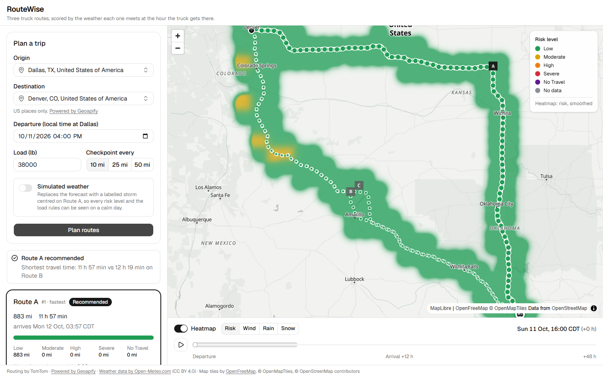
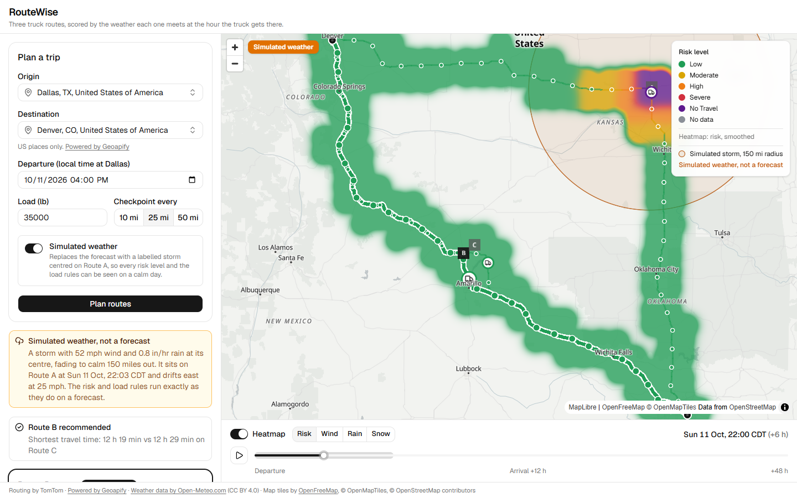

# RouteWise

[](https://github.com/mahianyuallan/routewise/actions/workflows/ci.yml)

Weather-aware truck routing. RouteWise plans three truck routes between two US places, forecasts the weather at the hour the truck reaches each checkpoint, scores it with Spotter's risk and load rules, and recommends the safest route, with travel time as the tie-breaker. The map shows the routes, every checkpoint's risk and ETA, and a 48-hour risk heatmap of the corridor.



## Live demo

| | |
|---|---|
| App | [routewise-two.vercel.app](https://routewise-two.vercel.app) |
| API | [routewise-api-h9q3.onrender.com/api/docs/](https://routewise-api-h9q3.onrender.com/api/docs/), the interactive OpenAPI page; health at [`/api/health/`](https://routewise-api-h9q3.onrender.com/api/health/) |
| Walkthrough | [Loom walkthrough](https://www.loom.com/share/9ce81f93bcb44d37ba5ef1626dd56e60) |

The API runs on a free Render instance kept awake by a monitor. If it has dozed off, the page says so and the first plan takes about a minute longer.

## How a plan is made

1. **Places.** Origin and destination come from Geoapify autocomplete (US only), each with coordinates and an IANA time zone. Departure is entered as wall-clock time at the origin.
2. **Routes.** Five TomTom Routing v1 calls run in parallel in truck mode for a standard 53-ft tractor-trailer: fastest, eco, short, and two routes steered through soft via points either side of the straight line. Near-duplicates (90% of their length within 250 m) are dropped and the first three distinct routes are labelled A, B and C.
3. **Checkpoints.** Every 10, 25 or 50 miles along each route, plus the origin and destination. Each checkpoint's ETA is the departure plus TomTom's truck- and traffic-aware travel time to that point, interpolated from the route's own distance/time profile. Each checkpoint stands for the road halfway to its neighbours, so miles add up to the route length.
4. **Weather.** Open-Meteo hourly forecasts, fetched once per 0.1° cell and cached for an hour. Sustained wind is interpolated to the ETA; rain, showers, snow and gusts come from the hour the truck is in (an ETA of 14:20 reads the 15:00 slot, which covers 14:00 to 15:00).
5. **Risk.** The brief's thresholds and load rules give each checkpoint a level and a plain-language reason.
6. **Ranking.** Miles at each level, average risk and travel time rank the routes; the UI names the rule that decided it.
7. **Heatmap.** A grid of at most 200 points within 25 miles of any route, classified with the same rules and load for the departure hour and the 48 hours after it. The slider changes an index into frames already in memory, so scrubbing makes no requests. A switch shows sustained wind, rain or snow instead of risk.

## Risk rules

Thresholds from the brief, read as half-open ranges so every value lands in exactly one level. A value on a shared edge takes the higher level (35 mph is High); the brief's strict ">1.00" and ">3.0" keep exactly 1.00 in/hr of rain and 3.0 in/hr of snow at Severe.

| Condition | Low | Moderate | High | Severe | No Travel |
|---|---|---|---|---|---|
| Wind (mph, sustained) | < 25 | 25 to < 35 | 35 to < 45 | 45 to < 55 | ≥ 55 |
| Rain (in/hr, rain + showers) | < 0.10 | 0.10 to < 0.25 | 0.25 to < 0.50 | 0.50 to 1.00 | > 1.00 |
| Snow (in/hr) | < 0.5 | 0.5 to < 1.0 | 1.0 to < 2.0 | 2.0 to 3.0 | > 3.0 |

Load rules, applied to the wind level (load is cargo weight in pounds, exactly as entered):

1. ≥ 55 mph → No Travel for any load.
2. 45 to < 55 mph and load > 30,000 lb → No Travel.
3. 35 to < 45 mph and load > 40,000 lb → Severe.

A checkpoint's level is the worst of wind (after the load rules), rain and snow. Values are rounded to what the UI shows (0.1 mph, 0.01 in/hr) before classification, so the level always matches the number on screen. A missing forecast value makes the checkpoint "No data": it is never counted as Low, it is left out of averages, and a route with any No data checkpoint can't be recommended.

Every boundary in the table, all three load rules and the rounding edge cases are parametrized tests in [`backend/trips/tests/test_risk.py`](backend/trips/tests/test_risk.py).

## Ranking and the recommendation

Routes are compared on each rule in turn, moving to the next only on a tie:

0. Fewest No Travel miles (added: the brief's list doesn't mention No Travel, and without it a route with 50 No Travel miles and no Severe miles would beat a route with 10 Severe miles)
1. Fewest Severe miles
2. Fewest High miles
3. Lowest average risk (Low 0 … No Travel 4, weighted by miles)
4. Shortest travel time

Miles are rounded to whole miles and average risk to one decimal before comparing, which keeps the order consistent across three routes. No Travel miles round up, so a short No Travel stretch can't pass as safe. Routes with missing weather rank after complete ones; a full tie keeps TomTom's order.

**Worked example** (Dallas → Denver, 35,000 lb, 25-mile checkpoints, with the [simulated storm](#simulated-weather) below):

| Route | Miles | Time | No Travel | Severe | High | Average risk |
|---|---|---|---|---|---|---|
| A (fastest) | 883 | 11 h 57 min | 25 | 0 | 50 | 0.28 → 0.3 |
| B (eco) | 793 | 12 h 19 min | 0 | 0 | 0 | 0.0 |
| C (via) | 804 | 12 h 29 min | 0 | 0 | 0 | 0.0 |

Route A is the fastest, but the storm meets it at mile 450, where 50.1 mph of wind with a 35,000 lb load is No Travel (load rule 2). Rule 0 puts it last. B and C tie on rules 0 to 3, so rule 4 decides: "Route B recommended. Shortest travel time: 12 h 19 min vs 12 h 29 min on Route C." With the real forecast at the same departure every route was Low, and travel time chose Route A, as in the screenshot at the top.

If every route has No Travel conditions, the ranking is still shown but the recommendation is replaced by "No safe route at this departure time", pointing at the heatmap to find a clearer window.

## Simulated weather

A calm review day leaves every route Low, so the form has a **Simulated weather** switch. It replaces the forecast with one made-up storm and runs the same checkpoint, risk, ranking and heatmap code; no forecast is fetched.

- **Where:** centred on Route A's checkpoint nearest the halfway point of its drive time, at that checkpoint's ETA, drifting east at 25 mph. The same trip always gets the same storm.
- **How strong:** sustained wind peaks at 52 mph and fades to calm 150 miles out; rain peaks at 0.8 in/hr and stops 60 miles out.
- **What it shows:** nothing reaches No Travel on weather alone, so the load rules do the visible work. At 25,000 lb the core checkpoint is Severe, at 35,000 lb it turns No Travel (rule 2), and at 45,000 lb the High ring turns Severe (rule 3). On Dallas → Denver the storm-hit route drops to last and another route is recommended.
- **Labelled everywhere:** a banner, every route card, every checkpoint tooltip, the legend and a badge on the map, where a ring shows the storm moving as the slider scrubs.



The plan response carries the storm in `trip.storm`, and the heatmap request sends its centre and time back, so the API stays stateless. Rule 1 (55 mph and above), rain and snow No Travel, and every snow level are covered by the tests instead.

## Around the map

- **Checkpoint table.** Under the selected route's card: every checkpoint's mile, ETA, wind, rain, snow and level, with the load rule that fired and the full reason on hover.
- **Play the forecast.** A play button steps the slider an hour at a time, and a truck on each route shows where it would be at that hour, ringed in the level of the stretch it is on.
- **Heatmap switch.** Risk, sustained wind, rain or snow. The weather views use one blue scale that darkens up to the reading the rules make No Travel, with the Moderate, High and Severe thresholds marked on the legend.
- **Phone layout.** Below 768 px the map fills the screen and the form and results move into a bottom sheet, which lowers itself when a plan arrives and names the recommended route on its handle.

## Assumptions

Where the brief leaves room, these are the calls made (each is a constant or a small function):

- **Load is cargo weight**, 0 to 45,000 lb. TomTom gets the gross weight, load plus an assumed 35,000 lb tare, and a 53-ft rig profile (13'6" tall, 8'6" wide, about 72 ft long, 5 axles), so it avoids low bridges and weight-restricted roads. 45,000 + 35,000 lb is the 80,000 lb federal limit.
- **Sustained wind** drives the rules; gusts are shown in the tooltip but not scored.
- **The load rules are applied as written**, even though industry blow-over guidance usually flags light trailers as most at risk.
- **The slider starts at the departure hour** (which is now when departing now), not the current hour, so a trip planned for Thursday gets Thursday's heatmap.
- **ETAs assume continuous driving.** Hours-of-service breaks are out of scope.
- **US only.** Autocomplete is filtered to the US and routes avoid border crossings.
- **Departures within the next 7 days**, so the trip and its 48-hour window stay inside the 16-day forecast. Past times are rejected; a time that happens twice when clocks go back takes its first occurrence; a time that doesn't exist when they go forward is rejected.

## API

| Method and path | Purpose |
|---|---|
| `GET /api/health/` | Keep-alive and wake-up check |
| `GET /api/places/?q=` | Up to 5 US places with coordinates and time zone |
| `POST /api/plan/` | Routes, checkpoints, risk, ranking and recommendation for a trip. Responds with a `Server-Timing` header: `tomtom`, `weather`, `compute` |
| `POST /api/heatmap/` | 49 hourly risk frames over the corridor, for the plan's routes |
| `GET /api/docs/` | Swagger UI; `GET /api/schema/` is the OpenAPI document |

The API is stateless: the heatmap call sends back the plan's simplified route outlines rather than looking up a stored plan, so a restart of the free instance loses nothing ([ADR 0003](docs/adr/0003-stateless-api.md)). The frontend's TypeScript types are generated from the OpenAPI schema, and CI fails if they drift.

## Run it locally

Backend (Python 3.13, [uv](https://docs.astral.sh/uv/)):

```bash
cd backend
cp .env.example .env      # add free TomTom and Geoapify keys
uv sync
uv run python manage.py runserver
```

Frontend (Node 24):

```bash
cd frontend
npm install
npm run dev               # http://localhost:5173, proxies /api to the backend
```

Environment variables are listed in [`backend/.env.example`](backend/.env.example) and [`frontend/.env.example`](frontend/.env.example). Both provider keys stay on the server; the browser only talks to the API and to OpenFreeMap for map tiles.

## Tests and CI

```bash
cd backend && uv run pytest        # 144 tests, every provider mocked with recorded responses
cd frontend && npm test            # 63 tests: palette and heatmap scales, formatting, geometry, trucks, playback, cards, table, legend, tooltips
```

[GitHub Actions](.github/workflows/ci.yml) runs Ruff, pytest with coverage, oxlint, Prettier, Vitest and the production build on every push, and checks that `requirements.txt` matches the lockfile and that the frontend's API types match the backend's schema.

## Performance

Measured on an 883-mile Dallas → Denver plan with 10-mile checkpoints (90 per route), against the live providers:

| | TomTom | Weather | Compute | Total |
|---|---|---|---|---|
| First plan (nothing cached), local machine | 5.1 s | 3.2 s | 0.1 s | 8.4 s |
| Repeat with weather cached, local machine | 4.6 s | 0.02 s | 0.2 s | 4.9 s |
| First plan (nothing cached), Render free instance | 3.3 s | 1.5 s | 0.4 s | 5.8 s |
| Repeat with weather cached, Render free instance | 3.4 s | 0.01 s | 0.5 s | 4.4 s |

The Render rows were measured against the live deployment on 11 October 2026 from a client in Nairobi, so the totals include the round trip; five warm repeats landed between 4.0 and 4.6 s, inside the 10 s target. A sleeping instance adds about 40 s to the first request.

What keeps it fast: the five routing calls run at once (TomTom's own alternatives took 11 to 14 s on this trip); weather is fetched per 0.1° cell and cached for an hour, so a changed load or departure re-plans in a few seconds; route geometry is simplified server-side; the map libraries load lazily after the form paints; and the slider only changes an index, so scrubbing 0 to 48 h makes no requests.

## Deploy

- **API:** [`render.yaml`](render.yaml) is a Render Blueprint for one free web service (`New +` → `Blueprint`). It asks only for the two provider keys. Health check: `/api/health/`.
- **UI:** a Vercel project with root directory `frontend` and `VITE_API_BASE_URL` set to the API's origin.
- **Keep-alive:** an UptimeRobot monitor on `/api/health/` every 5 minutes keeps the free instance inside its 15-minute idle window.

## Known limitations

- Forecasts are forecasts: a checkpoint shows the model's best estimate for that hour.
- Wider checkpoint spacing can miss a short storm between checkpoints; the heatmap helps spot it.
- ETAs ignore rest breaks, fuel stops and live incidents.
- The free API instance has 0.1 CPU and sleeps after 15 idle minutes without the keep-alive monitor.
- Open-Meteo's free API is for non-commercial use; a production deployment would need a subscription.
- Open-Meteo's free limits (600 calls a minute, 10,000 a day) count every location as a call, and a cold Dallas → Denver plan with its heatmap is about 450. A free Render instance shares its outbound addresses with other services, so their traffic can use up the forecast quota first: this happened on 11 October. The app then says which limit was hit and points at simulated weather, which needs no forecast.

## Documents

- [Product requirements](docs/PRD.md)
- [Tech stack and build decisions](docs/TECH-STACK.md)
- [Glossary](GLOSSARY.md)
- [Architecture decision records](docs/adr/)

## Attributions

Routing by [TomTom](https://developer.tomtom.com/). Places [powered by Geoapify](https://www.geoapify.com/). [Weather data by Open-Meteo.com](https://open-meteo.com/) (CC BY 4.0). Map tiles by [OpenFreeMap](https://openfreemap.org/), © [OpenMapTiles](https://openmaptiles.org/), © [OpenStreetMap](https://www.openstreetmap.org/copyright) contributors.
