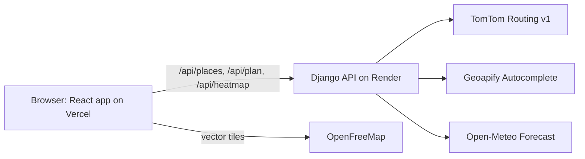

# RouteWise tech stack

Weather-aware truck routing · 10 Oct 2026 · Allan Mwenja Mahianyu
Updated 11 Oct 2026 after the design review. Matches [PRD v2](PRD.md), the [glossary](../GLOSSARY.md) and the [ADRs](adr/).

## Stack at a glance

**Every layer below is free to run; versions, limits and terms were checked on 10 October 2026.** Versions are the latest stable releases that work together; pin them in your lockfiles.

| Layer | Pick | Version | Why it wins |
| --- | --- | --- | --- |
| Routing | [TomTom Routing API](https://docs.tomtom.com/routing-api/documentation/tomtom-maps/v1/calculate-route), `travelMode=truck` | API v1 | Only free API found whose docs cover a truck profile, up to 5 alternatives and per-point travel times ([ADR 0002](adr/0002-tomtom-routing-v1-not-orbis.md)) |
| Geocoding | [Geoapify Address Autocomplete](https://apidocs.geoapify.com/docs/geocoding/address-autocomplete/) | API v1 | Coordinates and IANA time zone come back with suggestions; commercial use allowed |
| Weather | [Open-Meteo Forecast API](https://open-meteo.com/en/docs) | API v1 | No key, hourly mph and in/hr, up to 1,000 points per request |
| Basemap tiles | [OpenFreeMap](https://openfreemap.org/), Positron style | public instance | No key, no view limits, commercial use allowed |
| Map renderer | [MapLibre GL JS](https://maplibre.org/maplibre-gl-js/docs/) | 6.13.0 | Open-source WebGL2 vector map, no token |
| React map binding | [react-map-gl](https://visgl.github.io/react-map-gl/docs/get-started) (`react-map-gl/maplibre`) | 8.1.3 | Declarative `Map` plus `useControl` to mount deck.gl |
| Data layers, heatmap | [deck.gl](https://deck.gl/docs/developer-guide/base-maps/using-with-maplibre): `@deck.gl/maplibre`, `layers`, `aggregation-layers` | 9.4.0 | GPU heatmap with MEAN aggregation, drawn under map labels |
| Build, language | [Vite](https://www.npmjs.com/package/vite), [React](https://www.npmjs.com/package/react), [TypeScript](https://www.npmjs.com/package/typescript) | 8.3.4, 19.3.0, 6.0.3 | Official `create-vite` react-ts template, which pins TypeScript \~6.0 |
| UI kit | [Tailwind CSS](https://www.npmjs.com/package/tailwindcss), [shadcn/ui](https://ui.shadcn.com/docs/installation/vite) CLI, [lucide-react](https://www.npmjs.com/package/lucide-react) | 4.3.3, 4.21.4, 1.55.0 | Accessible Radix slider, combobox and tooltip that live in your repo |
| Server state | [TanStack Query](https://www.npmjs.com/package/@tanstack/react-query) | 5.104.1 | Caching, request cancellation and retries |
| UI state | [Zustand](https://www.npmjs.com/package/zustand) | 5.0.15 | Selector subscriptions keep slider ticks from re-rendering the page |
| Forms | [React Hook Form](https://www.npmjs.com/package/react-hook-form), [Zod](https://www.npmjs.com/package/zod), [@hookform/resolvers](https://www.npmjs.com/package/@hookform/resolvers) | 7.89.0, 4.6.5, 5.9.1 | Typed validation with little code |
| Backend | Python, [Django](https://www.djangoproject.com/download/) LTS | 3.13, 5.2.18 | Every package below declares 5.2 support; security fixes until April 2028 |
| API layer | [Django REST Framework](https://pypi.org/project/djangorestframework/), [drf-spectacular](https://pypi.org/project/drf-spectacular/) | 3.18.3, 0.30.0 | Serializers, throttling, OpenAPI docs page |
| Outbound HTTP | [requests](https://pypi.org/project/requests/), [tenacity](https://pypi.org/project/tenacity/) | 2.34.2, 9.2.1 | Explicit timeouts and retries on 429 and 5xx |
| Geometry, math, time | [Shapely](https://pypi.org/project/shapely/), [pyproj](https://pypi.org/project/pyproj/), [NumPy](https://pypi.org/project/numpy/), `zoneinfo`, [timezonefinder](https://pypi.org/project/timezonefinder/) | 2.2.0, 3.8.0, 2.5.3, stdlib, 9.0 | Corridor buffers, route dedupe, vectorized distance interpolation, time zones |
| Serving, config | [gunicorn](https://pypi.org/project/gunicorn/), [WhiteNoise](https://pypi.org/project/whitenoise/), [django-environ](https://pypi.org/project/django-environ/), [django-cors-headers](https://pypi.org/project/django-cors-headers/) | 26.2.0, 6.12.0, 0.14.0, 4.9.0 | Production server, static files, `.env` settings, cross-origin API |
| Storage, cache | SQLite with no models, Django `LocMemCache` | built in | Nothing is stored. The cache is best-effort, so the API keeps no state between requests ([ADR 0003](adr/0003-stateless-api.md)) |
| Python tooling | [uv](https://pypi.org/project/uv/), [Ruff](https://pypi.org/project/ruff/), [pytest](https://pypi.org/project/pytest/), [pytest-django](https://pypi.org/project/pytest-django/), [responses](https://pypi.org/project/responses/), [time-machine](https://pypi.org/project/time-machine/) | 0.13.0, 0.17.0, 9.1.1, 4.14.0, 0.26.3, 3.5.1 | Lockfile, lint and format, tests, HTTP mocks, frozen clocks |
| JS tooling | [Node LTS](https://nodejs.org/en/about/previous-releases), [oxlint](https://www.npmjs.com/package/oxlint), [Prettier](https://www.npmjs.com/package/prettier), [Vitest](https://www.npmjs.com/package/vitest), [Testing Library](https://www.npmjs.com/package/@testing-library/react), [jsdom](https://www.npmjs.com/package/jsdom) | 24.21.0, 1.87.0, 3.9.10, 5.0.3, 16.3.3, 30.1.2 | Template defaults plus a test runner that reuses the Vite config |
| Hosting | [Vercel Hobby](https://vercel.com/docs/plans/hobby) for the UI, [Render free web service](https://render.com/docs/free) for Django | free | UI loads instantly; the API moves to Vercel if it proves too slow on Render ([ADR 0001](adr/0001-render-free-api-with-keepalive.md)) |
| Keep-alive | [UptimeRobot](https://uptimerobot.com/pricing/) free monitor | 5-minute checks | Keeps the Render instance awake for reviewers |
| CI | GitHub Actions | | Lint, type-check, test and build on every push; free on a public repo |
| Walkthrough | [Loom](https://www.loom.com/pricing) | free | Business + AI trial only if sign-up asks for no card, otherwise two Starter parts under 5 min; unlisted YouTube copy as backup |



The React app never holds a provider key: it sends coordinates to Django, which calls TomTom, Geoapify and Open-Meteo and returns finished routes, checkpoints and heatmap frames. Only the basemap tiles go straight from the browser to OpenFreeMap. The API keeps nothing between requests: the heatmap call sends back the plan data it needs.

## Routing API

**Use the TomTom Routing API v1 (TomTom Maps) `calculateRoute` with `travelMode=truck`.** It is the only free option found whose docs cover all four needs: a real truck profile, up to 5 alternatives on long-haul trips, departure-time traffic, and cumulative travel time per route point for checkpoint ETAs. TomTom's newer Orbis routing does not support trucks, so do not follow their "use Orbis for new projects" banner here.

| Provider | Deciding facts | Verdict |
| --- | --- | --- |
| [TomTom Routing v1](https://docs.tomtom.com/routing-api/documentation/tomtom-maps/v1/calculate-route) | `travelMode=truck` with `vehicleWeight` in kg, axles, dimensions and US hazmat classes; `maxAlternatives` 0 to 5; `progress` gives travel time per route point; 20K routing requests a month free, no card ([pricing](https://docs.tomtom.com/pricing)) | Use this |
| TomTom Orbis [v2](https://docs.tomtom.com/routing-api/documentation/tomtom-orbis-maps/v2/calculate-route) and [v3](https://docs.tomtom.com/routing-api/documentation/tomtom-orbis-maps/v3/calculate-route) | `travelMode` is `car` only in v2 and `car` or `taxi` in v3, so there is no truck profile | Skip for trucks |
| [openrouteservice](https://openrouteservice.org/restrictions/) | Alternative routes only on trips up to 100 km, at most 3 | Fails long-haul alternatives |
| [Mapbox Directions](https://docs.mapbox.com/api/navigation/directions/) | No truck profile, only `max_weight` in tonnes; at most 2 alternatives, and not guaranteed | Car fallback only |
| [GraphHopper](https://www.graphhopper.com/pricing/) | Free plan: 500 credits a day, non-commercial, a limited set of vehicle profiles, no flexible mode | Quota too small |
| [Stadia Maps (Valhalla)](https://docs.stadiamaps.com/routing/standard-routing/) | Truck access restrictions plus weight and height attributes; free plan 200K credits a month at 20 per route, non-commercial ([pricing](https://stadiamaps.com/pricing/)); alternates not documented in detail | Backup option |

### The request

```http
GET https://api.tomtom.com/routing/1/calculateRoute/{oLat},{oLon}:{dLat},{dLon}/json
  ?key=$TOMTOM_API_KEY
  &travelMode=truck
  &vehicleCommercial=true
  &vehicleWeight={round((load_lb + 35000) * 0.45359237)}
  &vehicleLength=21.9
  &vehicleWidth=2.59
  &vehicleHeight=4.11
  &vehicleNumberOfAxles=5
  &routeType=fastest
  &avoid=borderCrossings
  &traffic=true
  &departAt=2026-10-12T06:00:00-05:00
  &routeRepresentation=polyline
  &extendedRouteRepresentation=distance
  &extendedRouteRepresentation=travelTime
  &computeTravelTimeFor=all
```

- **Response shape:** `routes[]` comes back in order of decreasing optimality. Each route has `summary` (`lengthInMeters`, `travelTimeInSeconds`, `departureTime`, `arrivalTime`, `trafficDelayInSeconds`), `legs[].points` as lat/lon objects, and `progress[]` entries of `pointIndex`, `distanceInMeters`, `travelTimeInSeconds`.
- **Checkpoint ETAs:** `progress` always includes the first and last point. TomTom documents that values between entries can be linearly interpolated using Haversine distances between the leg points. ETA at mile N = `departAt` + interpolated travel time at that distance.
- **`departAt`:** RFC 3339. With no offset, TomTom assumes the origin's time zone, so always send an explicit offset or `Z`.
- **Load and `vehicleWeight`:** the form's load is **cargo weight** in pounds, 0 to 45,000. TomTom gets the gross weight: load plus an assumed 35,000 lb tare (tractor plus empty 53-ft trailer), converted to kilograms (1 lb = 0.45359237 kg). Capping load at 45,000 lb keeps gross at or under the 80,000 lb federal limit. Weight restrictions only apply when `vehicleWeight` is non-zero, and the tare keeps it non-zero even for an empty trailer.
- **Rig profile:** every request describes a standard 53-ft tractor-trailer: 21.9 m long (about 72 ft), 2.59 m wide (8'6"), 4.11 m tall (13'6"), 5 axles. Dimensions default to 0, which means no restriction, so without them TomTom would ignore low bridges. The README states the tare and the profile as assumptions.
- **Border crossings:** every request sets `avoid=borderCrossings`. The trips are US domestic, and a via point near the edge of the country must not steer a route through Canada or Mexico.
- **Quota behaviour:** past the free allowance, TomTom returns HTTP 429. With no card on file nothing is charged ([FAQ](https://docs.tomtom.com/platform/documentation/status-and-support/faqs)). A plan makes 5 routing calls, so 20K a month covers about 4,000 plans.
- **Timeouts:** long routes with alternatives cost more compute. A request that hits TomTom's internal limit returns HTTP 500, and `avoid=motorways` on routes over about 500 km is documented as a timeout risk. Give TomTom a generous client timeout, about 45 s, and handle the error.

### Getting three routes

**One parallel wave of five single-route calls, then dedupe.** Asking TomTom for alternatives (`maxAlternatives=2`) measured 7.9 s for one 800-mile call. It often returned fewer than 3 routes, so a second, sequential round of via-point calls followed: 11 to 14 s at TomTom alone. Five single-route calls in parallel measured 4.5 to 4.9 s and gave 4 distinct routes on both test trips (Dallas–Denver, Chicago–Atlanta).

1. **The wave:** `routeType=fastest`, `routeType=eco`, `routeType=short`, and two `fastest` calls steered by soft via points, all at once. Avoid `routeType=shortest` on long trips; TomTom says it suits only short to medium distances.
2. **Via points:** a `circle(lat,lon,radiusMeters)` waypoint either side of the straight line's midpoint. The offset is 15% of the straight-line distance, clamped to 25–100 km, and the radius is a third of the offset (under TomTom's 135,000 m cap). Circle waypoints steer the route without adding a leg. They're computed from the straight line, so they don't wait for the first route.
3. **Dedupe:** sample each route every kilometre in a projected CRS, buffer it by 250 m, and treat 90% or more shared length (either way) as the same route.
4. **Still short:** show the routes that exist and say why, for example origin and destination in the same town.
5. **Labels:** the first three distinct routes are labelled A, B, C in the wave's order (fastest, eco, short, via, via). A label never changes within a plan. Cards are sorted by rank, and each route records how it was produced, so the UI and the Loom can explain it.
6. **Failures:** a variant that fails is skipped. The plan fails only if every call does, and then reports the first call's error.

## Geocoding and autocomplete

**Use Geoapify Address Autocomplete, called through a Django proxy.** Every suggestion already carries `lat` and `lon`, so one debounced call per keystroke is enough, and the free plan allows production and commercial use with attribution.

| Provider | Coordinates in each suggestion | Free tier | Verdict |
| --- | --- | --- | --- |
| [Geoapify Autocomplete](https://apidocs.geoapify.com/docs/geocoding/address-autocomplete/) | Yes | 3,000 credits a day, 1 credit per request, 5 requests/s, no card ([pricing](https://www.geoapify.com/pricing/)) | Use this |
| [TomTom Places Suggest](https://docs.tomtom.com/places-search-api/documentation/places-search/suggest) | No: each pick needs a follow-up Details call | Suggest 10K a month, Details 5K a month | Single-vendor fallback |
| [Nominatim (public OSM)](https://operations.osmfoundation.org/policies/nominatim/) | Yes | 1 request/s max | Banned: the policy forbids autocomplete |

```http
GET https://api.geoapify.com/v1/geocode/autocomplete
  ?text=dallas
  &filter=countrycode:us
  &limit=5
  &format=json
  &apiKey=$GEOAPIFY_API_KEY
```

- **Flow:** the user picks a suggestion, and form state keeps its `lat`, `lon`, `formatted` label and `timezone.name` (IANA). The trip request sends coordinates. The backend never re-geocodes free text.
- **Missing time zone:** Geoapify says some fields can be missing on some results. When `timezone.name` is absent, the server derives the zone from the coordinates with timezonefinder.
- **Keystroke hygiene:** debounce about 300 ms, start at 3 characters, and cancel stale requests (TanStack Query passes an `AbortSignal` to your fetcher).
- **Caching:** cache normalized queries in Django for 24 hours. Repeated demo searches then cost nothing.
- **US only:** `filter=countrycode:us` is a hard filter (`bias` would only re-rank), matching the brief's US units: mph, inches, pounds. A place with no road link to the mainland, such as Hawaii, gets a clear "no road route" error.
- **Attribution:** show a "Powered by Geoapify" link near the inputs, as their free-plan terms require.
- **Key hygiene:** keep the key server-side. Geoapify also lets you restrict a key by referrer, origin or IP if you ever call it from the browser.

## Weather API

**Use the Open-Meteo Forecast API.** It is free with no key, gives hourly data up to 16 days ahead, converts to mph and inches for you, keeps rain and snowfall separate, and takes up to 1,000 coordinates in one request. By default it picks the highest-resolution model for each point; in the US that includes NOAA's GFS and HRRR at 3 to 25 km.

```http
GET https://api.open-meteo.com/v1/forecast
  ?latitude=32.8,33.2,33.6
  &longitude=-96.8,-97.1,-97.4
  &hourly=wind_speed_10m,wind_gusts_10m,rain,showers,snowfall
  &wind_speed_unit=mph
  &precipitation_unit=inch
  &timeformat=unixtime
  &timezone=GMT
  &forecast_days=11
```

- **One window per cell:** fetch each cell's next 11 days once and slice it per trip. That still counts as one call per location: under 2 weeks and under 10 variables. It covers a departure 7 days out, the trip and the 48-hour heatmap. Trips with different departures then share the cache.
- **Checkpoints** read the series at their ETA.
- **Heatmap** frames read 49 hours starting at the departure hour. Do **not** use `forecast_hours=49`: it starts at the current hour, so a departure 3 days out would get a heatmap that ends before the truck leaves.
- **Units guard:** check the response's `hourly_units` (Open-Meteo writes mph as `mp/h`) and fail loudly unless they are mph and inches.
- **Response shape:** several locations come back as a list; a single location comes back as one object.

### Spec condition to API variable

| Spec condition | Variable | Valid time | Unit with the params above |
| --- | --- | --- | --- |
| Wind (mph) | `wind_speed_10m` for the rule, `wind_gusts_10m` for display | Wind is instant at the hour; gusts are the max of the preceding hour | mph |
| Rain (in/hr) | `rain` + `showers` | Sum of the preceding hour | inches, so the hourly value is already in/hr |
| Snow (in/hr) | `snowfall` | Sum of the preceding hour | inches of new snow (cm by default) |

- **Do not use `precipitation` for the rain rule.** It is rain plus showers plus snow, so snow would be counted twice.
- **Hour alignment:** a value stamped 15:00 covers 14:00 to 15:00. For an ETA of 14:20, rain, showers, snow and gusts come from the 15:00 slot. Sustained wind is an instantaneous reading, so it is interpolated linearly between 14:00 and 15:00.
- **Sustained vs gust:** the spec says "Wind" only. Classify on sustained `wind_speed_10m`, show gusts in the tooltip, and state the choice in the README.
- **Multi-location responses** come back as a list of per-location objects in request order. Each object's `latitude`/`longitude` is the model grid-cell centre, not your input point, so map results back by index.
- **`timeformat=unixtime`** gives UTC epoch seconds, which line up with ETAs computed from TomTom without any time zone parsing.

### Quotas, budget and caching

- **Free tier:** under 600 calls a minute, 5,000 an hour, 10,000 a day and 300,000 a month, non-commercial use only, CC BY 4.0 attribution required ([terms](https://open-meteo.com/en/terms)).
- **Counting:** a request's weight scales with its number of locations, so each location counts as a call. A location with more than 10 variables or more than 2 weeks of data counts fractionally more ([pricing FAQ](https://open-meteo.com/en/pricing), [multi-location note](https://openmeteo.substack.com/p/weather-data-for-multiple-locations)). Five variables over a few days costs 1 per location.
- **Why a budget:** a 1,000-mile trip at 10-mile spacing has about 100 checkpoints a route, 300 for three routes. Add a few hundred heatmap points and one uncached plan would break the 600-a-minute limit by itself.
- **The budget:** at most **500 locations per plan**, made up of at most 300 checkpoint cells after dedupe and at most 200 heatmap points.
  - **Spacing:** the default is 25 miles. If the chosen spacing would need more than 300 cells, the server uses the smallest spacing that fits (10 → 25 → 50), and the response says so. 10-mile spacing covers trips up to about 1,000 miles.
  - **Daily limit:** 10,000 a day allows about 20 fully uncached plans, and the cell cache makes repeats nearly free.
- **Cache per grid cell, not per URL.** Snap checkpoints and heatmap points to a 0.1° lattice, dedupe across routes, and cache each cell's hourly series in Django's cache for 60 minutes. URL-level caching like `requests-cache` rarely hits because coordinate lists differ between trips.
- **Shared IPs:** Render's outbound IPs are shared with other services. If Open-Meteo applies its free limits per IP, a 429 can come from someone else's traffic. Retry with backoff, then say "Weather service busy, try again in a minute".
- **Chunking:** send about 200 coordinates per request to keep GET URLs a safe length, and run chunks concurrently.
- **Attribution:** put "Weather data by Open-Meteo.com" with a link in the UI footer. If Spotter ever used this commercially, they would need an Open-Meteo subscription.

### Client library

Use `requests` with `tenacity` for all three providers: one timeout policy, retries on 429, 5xx and timeouts, and an API every reviewer knows. Run Open-Meteo chunks and the first wave of TomTom calls in a `ThreadPoolExecutor` where each task makes its own `requests.get` call, so nothing is shared across threads. `httpx` has had no release since 0.28.1 in December 2024, and the official [`openmeteo-requests`](https://pypi.org/project/openmeteo-requests/) 1.7.5 client is marked alpha with an accessor-style API that reads less clearly in review.

## Map, routes and heatmap

**Render the map with MapLibre GL JS 6 through react-map-gl 8, and draw routes, checkpoints and the heatmap with deck.gl 9.4 mounted as a `MapLibreOverlay` in interleaved mode.** deck.gl's docs recommend `@deck.gl/maplibre`, not `@deck.gl/mapbox`, for MapLibre v4.5.1 through v6 ([guide](https://deck.gl/docs/developer-guide/base-maps/using-with-maplibre)). Interleaved mode draws deck.gl layers between MapLibre layers, so the heatmap can sit under city labels; it needs WebGL2, which MapLibre 6 requires anyway.

```bash
npm install maplibre-gl react-map-gl @deck.gl/core @deck.gl/layers @deck.gl/aggregation-layers @deck.gl/maplibre
```

### MapLibre 6 gotchas

MapLibre 6.0 shipped on 22 July 2026 with breaking changes that most tutorials predate ([migration guide](https://maplibre.org/maplibre-gl-js/docs/guides/v5-to-v6-migration-guide/)):

- **No default export.** Use `import * as maplibregl from 'maplibre-gl'` or named imports.
- **Bundlers must set the worker URL once**, before the first map renders ([install docs](https://maplibre.org/maplibre-gl-js/docs/)):

```ts
// src/main.tsx
import {setWorkerUrl} from 'maplibre-gl';
import workerUrl from 'maplibre-gl/dist/maplibre-gl-worker.mjs?worker&url';
import 'maplibre-gl/dist/maplibre-gl.css';

setWorkerUrl(workerUrl);
```

- **WebGL2 is required.** Without it the `Map` constructor throws `GPUInitializationError`; catch it and show a message rather than a grey box.
- **ESM only.** Do not render the real map inside Vitest and jsdom; mock the map component in tests.

### Mounting deck.gl

```tsx
import {Map, useControl} from 'react-map-gl/maplibre';
import {MapLibreOverlay, type MapLibreOverlayProps} from '@deck.gl/maplibre';

function DeckGLOverlay(props: MapLibreOverlayProps) {
  const overlay = useControl<MapLibreOverlay>(() => new MapLibreOverlay(props));
  overlay.setProps(props);
  return null;
}

<Map initialViewState={view} mapStyle="https://tiles.openfreemap.org/styles/positron">
  <DeckGLOverlay layers={layers} interleaved />
</Map>
```

The Vite template sets `verbatimModuleSyntax: true`, so type-only imports need the `type` keyword as above or the build fails.

### Layers

| What | deck.gl layer | Notes |
| --- | --- | --- |
| 3 routes | `PathLayer` | Split each route at the midpoints between checkpoints and colour each piece by its checkpoint's risk level; draw the selected route wider and on top |
| Checkpoints | `ScatterplotLayer` | `pickable: true`; tooltip shows mile, ETA, wind, gust, rain, snow, the level, and the checkpoint reason |
| Weather heatmap | `HeatmapLayer` | Corridor grid of at most 200 points, 49 hourly frames |
| Origin, destination | `ScatterplotLayer` or `IconLayer` | Two points |

### Heatmap that scrubs smoothly from 0 to 48 h

1. **Server builds the frames.** The backend builds a grid over the **corridor**: the three routes buffered 25 miles on each side. The grid holds at most 200 points, spaced to fit the corridor's area and snapped to the 0.1° cache lattice. It fetches the departure hour through +48 h, classifies every point-hour with the same risk function and the trip's load, and returns arrays laid out hour by point.
2. **The slider only changes an index.** Use `getWeight: (_, {index}) => values[hour * n + index]` with `updateTriggers: {getWeight: [metric, hour]}`, so scrubbing makes no network calls and allocates no new data.
3. **Set `aggregation: 'MEAN'`.** The default `SUM`, like MapLibre's built-in heatmap, adds weights together, so places with more grid points look riskier than they are.
4. **Fix `colorDomain`.** Without it deck.gl rescales colours to the maximum in the current viewport, so colours shift as you pan and no legend stays true ([HeatmapLayer docs](https://deck.gl/docs/api-reference/aggregation-layers/heatmap-layer)).
5. **Weight = risk level plus one (1 to 5), with `colorDomain: [1, 5]`.** Pixels below the domain minimum fade to transparent, so a 0 for Low would make safe stretches invisible.
6. **Lower `weightsTextureSize` to 1024 or 512.** deck.gl measures aggregation at 50 to 100 ms for a 2048 texture versus 5 to 7 ms at 512.
7. **Scale `radiusPixels` with zoom** so each point always covers about 1.5 grid spacings; otherwise the field breaks into separate blobs when zoomed in.
8. **iOS Safari:** deck.gl falls back to 8-bit weights that must be integers, which the 1 to 5 risk levels already are.
9. **Honest legend:** MEAN blends neighbours. Between a Low point and a No Travel point it paints in-between colours that no grid point has, so the legend reads "Risk (smoothed)". Exact levels live on the checkpoints.

For the slider, use the shadcn `Slider` (Radix) with min 0, max 48, step 1. Hour 0 is the departure hour. Label each step with the clock time in the origin's zone plus the offset ("Sat 14:00 CDT, +6 h"), and shade the departure-to-arrival window on the track. The play button that advances one hour every few hundred milliseconds is P1 (S3).

### Basemap

- **OpenFreeMap Positron** at `https://tiles.openfreemap.org/styles/positron`: low-saturation, so risk colours stand out. No key, no view limits, commercial use allowed, attribution added automatically by MapLibre, no SLA ([OpenFreeMap](https://openfreemap.org/)).
- **Fallback:** Stadia Maps free plan, 200,000 credits a month at 1 credit per vector tile, non-commercial only.

### Performance checklist

- Lazy-load the map module with `React.lazy` so the form paints before the map libraries download.
- Simplify route geometry on the server (Shapely `simplify` in metres, about 25 m tolerance) before sending it; TomTom polylines are dense.
- Build layers in `useMemo` with stable `id`s so deck.gl diffs props instead of recreating layers.
- Call `fitBounds` once per plan on the union of the three routes.
- Pass `beforeId` as the first `symbol` layer in the loaded style so the heatmap sits under labels.
- Keep the slider hour in Zustand and subscribe only the map and the time label to it.
- Define one ordered five-step palette, Low to No Travel, and reuse it for segments, checkpoints, heatmap and legend. Low must stay clearly visible on Positron's near-white land; a near-white Low would make most of a calm route vanish. The level is always also shown as text (labels, tooltips, legend, cards), never by colour alone.

## Django backend

**Use Python 3.13, Django 5.2 LTS and Django REST Framework 3.18, with all routing, weather and risk logic in plain Python service modules that the views only call.** Django 6.1.2 is newer and DRF supports it, but django-cors-headers, drf-spectacular, WhiteNoise, pytest-django and django-environ have not declared 6.1 support yet. Every one of them declares 5.2, which gets security fixes until April 2028 ([Django downloads](https://www.djangoproject.com/download/)).

### Dependencies (`pyproject.toml`, managed with uv)

```toml
[project]
name = "routewise-api"
version = "0.1.0"
requires-python = ">=3.13,<3.14"
dependencies = [
  "django>=5.2.18,<6.0",
  "djangorestframework>=3.18.3",
  "drf-spectacular>=0.30.0",
  "django-cors-headers>=4.9.0",
  "django-environ>=0.14.0",
  "requests>=2.34.2",
  "tenacity>=9.2.1",
  "shapely>=2.2.0",
  "pyproj>=3.8.0",
  "numpy>=2.5.3",
  "timezonefinder>=9.0",
  "gunicorn>=26.2.0",
  "whitenoise>=6.12.0",
]

[dependency-groups]
dev = [
  "pytest>=9.1.1",
  "pytest-django>=4.14.0",
  "pytest-cov>=7.1.0",
  "responses>=0.26.3",
  "time-machine>=3.5.1",
  "ruff>=0.17.0",
]
```

- **Pin Python 3.13** with a one-line `.python-version` file. Render's default for new services is 3.14.3, while gunicorn 26.2 only lists support up to 3.13 ([Render Python versions](https://render.com/docs/python-version)). NumPy 2.5 and pyproj 3.8 need 3.12 or newer.
- **For Render**, export a plain requirements file: `uv export --format requirements.txt --no-hashes --no-dev -o requirements.txt`, then build with `pip install -r requirements.txt`.

### Project layout

```text
backend/
  config/              settings.py, urls.py, wsgi.py
  trips/
    api/               serializers.py, views.py, urls.py, errors.py
    services/
      planner.py       one plan end to end, with per-stage timings
      geocoding.py     Geoapify client, time-zone fallback
      routing.py       TomTom client, parallel wave of five calls, dedupe
      sampling.py      cumulative miles, checkpoints, ETAs, spacing budget
      weather.py       weather provider interface, Open-Meteo client, cell cache
      simulated.py     simulated storm provider (S2, P1)
      risk.py          thresholds and load rules, pure functions
      scoring.py       miles at each level, ranking, deciding rule
      heatmap.py       corridor grid, 49 hourly frames
      departure.py     local departure to UTC, clock changes
      geo.py, http.py, errors.py, timeutil.py   shared helpers
    tests/             one file per service, plus the API end to end
```

### Endpoints

| Method and path | Input | Output |
| --- | --- | --- |
| `GET /api/health/` | none | `{"status": "ok"}` for the keep-alive monitor |
| `GET /api/places/?q=` | text, 3+ characters | Up to 5 `{label, lat, lon, timezone}` |
| `POST /api/plan/` | origin and destination (label, lat, lon, timezone); `departure_local`; `load_lb` (0 to 45,000); `spacing_miles` (10, 25 or 50); `weather_source` (`forecast` or `simulated`, default `forecast`) | Up to 3 routes with label, source, summary, simplified geometry, checkpoints, miles at each level, average risk and rank. Also: the recommendation with its deciding rule (or none, with the reason), `spacing_used` with a notice when it was widened, and the storm parameters when simulated |
| `POST /api/heatmap/` | the plan's simplified route geometries, departure (UTC), `load_lb`, `weather_source` and any storm parameters | Grid points, 49 hourly timestamps, value arrays per metric |
| `GET /api/docs/` | none | Swagger UI from drf-spectacular |

The heatmap has its own endpoint so the routes paint first and the heavier grid loads after. It is **stateless**: the browser sends back what the server needs, and the server caps the number of points it accepts. A Render restart, a tab left open for an hour, or a move to Vercel changes nothing ([ADR 0003](adr/0003-stateless-api.md)).

### What `POST /api/plan/` does

1. **Validate** with a DRF serializer:
   - Coordinates are in range.
   - `load_lb` is a whole number from 0 to 45,000.
   - Spacing is 10, 25 or 50.
   - Departure is from now to 7 days out, so the whole trip stays inside the 16-day forecast. A departure before now is rejected with "Pick a time from now on". The plan is for a trip that hasn't started.
2. **Read `departure_local`** as wall-clock time at the origin, using `datetime.fromisoformat(s).replace(tzinfo=ZoneInfo(origin_tz))` from the standard library. A time that happens twice when the clocks go back takes its first occurrence (`fold=0`). A time that doesn't exist when the clocks go forward is rejected. Send it to TomTom as RFC 3339 with its offset.
3. **Get three routes** from TomTom with the parallel first wave in the routing section.
4. **Place checkpoints.** Per route, compute cumulative miles per vertex (NumPy haversine) and place checkpoints every N miles plus the origin and destination. Widen N if the 300-cell budget would be exceeded. Interpolate lat, lon and travel time with `np.interp`; ETA is departure plus travel time.
5. **Classify and rank.** Fetch weather for every checkpoint cell not already cached, classify each checkpoint, then score and rank the routes.
6. **Return the plan** with a `Server-Timing` header that splits the time into `tomtom`, `weather` and `compute`.

### Concurrency, caching and limits

- **Server:** `gunicorn config.wsgi:application --workers 1 --threads 8 --timeout 120 --bind 0.0.0.0:$PORT`. One process shares one `LocMemCache` across requests; the longer timeout covers slow long-haul TomTom calls.
- **Cache is best-effort:** Render may restart a free instance at any time, which empties it. Nothing depends on it except speed and quota.
- **Cache lifetimes:** place searches 24 hours, weather cells 60 minutes. Cap the cache's entry count so it stays inside Render's 512 MB.
- **Throttle** `POST /api/plan/` and `POST /api/heatmap/` with DRF's `AnonRateThrottle` at 60 per hour per IP, so a crawler cannot drain the TomTom and Open-Meteo quotas but a reviewer trying several loads never hits it. Set `NUM_PROXIES` so the throttle sees the client's IP behind Render's proxy.
- **Timeouts and retries:** Open-Meteo 15 s per chunk and Geoapify 5 s, each retried twice with backoff on 429, 5xx and timeouts. TomTom gets 45 s and one retry on 429 or 5xx, but none on a timeout: a long route that times out once will time out again. Never retry a 400.
- **Error mapping:** TomTom `NO_ROUTE_FOUND` or `MAP_MATCHING_FAILURE` becomes a 422 with a readable message. Provider quota errors become a 503 that says which provider is out of quota.

### Settings checklist

- `DEBUG`, `SECRET_KEY`, `ALLOWED_HOSTS` and the provider keys come from the environment through django-environ.
- `CORS_ALLOWED_ORIGINS` lists the Vercel URL and `http://localhost:5173`.
- `SECURE_PROXY_SSL_HEADER = ("HTTP_X_FORWARDED_PROTO", "https")`, because Render terminates TLS in front of Django.
- WhiteNoise middleware directly after `SecurityMiddleware`, and `collectstatic` in the build, so DRF and admin assets load.
- `GZipMiddleware` to shrink the plan and heatmap JSON.
- SQLite stays only because Django expects a database. There are no models and nothing is stored.

### Geometry rules

- Never buffer or measure in raw degrees: a degree of longitude shrinks with latitude.
- Project with pyproj to an azimuthal equidistant CRS centred on the trip (`+proj=aeqd +lat_0=… +lon_0=… +units=m`), then use Shapely for `buffer`, `simplify` and overlap length.
- Select corridor grid points with the vectorized `shapely.contains_xy` instead of a Python loop.

## React frontend

**Scaffold with the official Vite react-ts template on Node 24 LTS, keep TypeScript on 6.0, and add Tailwind, shadcn/ui, TanStack Query, Zustand, React Hook Form and Zod.** TypeScript 7.0.2 is npm's `latest`, but `create-vite` 9.2.1 pins `~6.0.2` and typescript-eslint 8.71 accepts only TypeScript below 6.1.

### Setup

```bash
# Node 24 LTS, 24.15 or later (this machine has 24.6.0: upgrade first).
# Vitest 5 needs Node 22.12+ and jsdom 30 needs 22.22.2+ or 24.15+.
npm create vite@latest frontend -- --template react-ts
cd frontend
npm install tailwindcss @tailwindcss/vite
npm install -D @types/node
# edit tsconfig and vite.config as below, then:
npx shadcn@latest init
npx shadcn@latest add button card input label slider tooltip popover command badge sonner switch
npm install @tanstack/react-query zustand react-hook-form zod @hookform/resolvers
npm install maplibre-gl react-map-gl @deck.gl/core @deck.gl/layers @deck.gl/aggregation-layers @deck.gl/maplibre
npm install -D vitest @testing-library/react @testing-library/jest-dom @testing-library/user-event jsdom prettier openapi-typescript
```

### Three version traps

- **`baseUrl` breaks TypeScript 6.** shadcn's Vite guide still says to add `"baseUrl": "."`, but TypeScript 6.0 deprecates it ([migration guide](https://blog.logrocket.com/typescript-v6-migration-guide/)). Add only `"paths": {"@/*": ["./src/*"]}` to `tsconfig.json` and `tsconfig.app.json`, plus the `resolve.alias` for `@` in `vite.config.ts` ([shadcn Vite guide](https://ui.shadcn.com/docs/installation/vite)).
- **TypeScript 6 defaults `types` to `[]`.** List every ambient type package you rely on; the template already lists `vite/client`.
- **The template now lints with oxlint, not ESLint.** Keep it and add Prettier. If you later want type-aware ESLint rules, ESLint 10, typescript-eslint 8.71 and eslint-plugin-react-hooks 7.1 support each other, which is one more reason to stay on TypeScript 6.0.

### Folder layout

```text
frontend/src/
  api/          client.ts, schema.d.ts (generated), queries.ts
  features/
    trip-form/  TripForm.tsx, PlaceCombobox.tsx
    map/        TripMap.tsx, DeckGLOverlay.tsx, layers.ts, Legend.tsx
    heatmap/    ForecastSlider.tsx, useHeatmap.ts
    results/    RouteCards.tsx, CheckpointTable.tsx (S4), Recommendation.tsx
  store/        ui-store.ts
  lib/          risk.ts (labels and palette), format.ts (Intl helpers)
```

### Data flow

- **Plan:** `useQuery({queryKey: ['plan', trip], queryFn, enabled: !!trip, placeholderData: keepPreviousData})`, where `trip` is set on submit and includes load, spacing and weather source. Identical trips come back from cache instantly. Changing the load re-submits the trip, because load also changes TomTom's weight restrictions. The old results stay on screen, dimmed, until the new plan arrives.
- **Heatmap:** a second `useQuery` keyed by the plan's routes, departure, load and weather source, enabled once the plan arrives. It POSTs the plan's simplified geometry to `/api/heatmap/`.
- **Places:** `useQuery` keyed by the debounced text, enabled at 3+ characters. Pass TanStack's `signal` to `fetch` so stale keystrokes are cancelled.
- **API base URL:** `import.meta.env.VITE_API_BASE_URL` in production. In development, a Vite `server.proxy` sends `/api` to `http://localhost:8000`, so there is no CORS to debug locally.
- **Shared types:** generate `schema.d.ts` from drf-spectacular's OpenAPI schema with `openapi-typescript` 7.13. The frontend then fails to compile when the API contract changes.

### Components and state

- **Place inputs:** shadcn Popover plus Command, the documented combobox pattern; show the Geoapify attribution under the inputs.
- **Departure:** native `<input type="datetime-local">`, defaulting to the next full hour and sent as a naive string together with the origin's time zone. The browser's own time zone never enters the calculation.
- **Times on screen:** every time, including arrival, is shown in the origin's zone with its abbreviation, using `Intl.DateTimeFormat` with the `timeZone` option. No date library needed.
- **Layout:** form and route cards on the left, map in the main area, slider along the bottom, legend top right. The checkpoint table for the selected route sits under its card (S4).
- **Route cards:** sorted by rank, labelled A, B, C by identity. The top card carries the **Recommended** badge.
- **Recommendation:** a banner that names the deciding rule, for example "Route B: 0 Severe miles vs 18 on Route A".
- **Weather source (S2):** a "Live forecast / Simulated storm" switch in the form. Simulated plans show a "Simulated weather" banner and the same label on every card, tooltip and the legend.
- **Zustand store:** selected route, hovered checkpoint, slider hour, heatmap metric and layer toggles. Components subscribe through selectors, so a slider tick re-renders only the map and the time label.

## Hosting and infrastructure

**Serve the React build from Vercel's free Hobby plan and run Django on a Render free web service, with an UptimeRobot monitor keeping Django awake.** The UI then loads instantly from a CDN even while the backend wakes, and nothing costs money ([ADR 0001](adr/0001-render-free-api-with-keepalive.md)).

| Piece | Service | Free-tier facts that matter |
| --- | --- | --- |
| Frontend | Vercel Hobby | Free, personal and non-commercial use only; Node 24.x is the default ([Hobby plan](https://vercel.com/docs/plans/hobby), [Node versions](https://vercel.com/docs/functions/runtimes/node-js/node-js-versions)) |
| Backend | Render free web service | 512 MB RAM and 0.1 CPU ([instance types](https://render.com/docs/compute-plans)). Sleeps after 15 minutes without inbound traffic and takes about a minute to wake. 750 instance hours a month per workspace. May restart at any time; disk resets on every restart ([Render free tier](https://render.com/docs/free)) |
| Keep-alive | UptimeRobot free monitor | 50 monitors at 5-minute intervals, no card ([UptimeRobot pricing](https://uptimerobot.com/pricing/)) |
| Database | None beyond SQLite in the container | Render's free Postgres expires 30 days after creation, possibly before reviewers look |
| Cache | In-process `LocMemCache` | Render's free Key Value is in-memory and wiped on restart, so it adds nothing for one process |

### Render service

- **Root directory** `backend`, Python runtime, `.python-version` set to `3.13`.
- **Build command:** `pip install -r requirements.txt && python manage.py collectstatic --noinput && python manage.py migrate --noinput`
- **Start command:** `gunicorn config.wsgi:application --workers 1 --threads 8 --timeout 120 --bind 0.0.0.0:$PORT`
- **Environment:** `SECRET_KEY`, `DEBUG=False`, `ALLOWED_HOSTS`, `CORS_ALLOWED_ORIGINS`, `TOMTOM_API_KEY`, `GEOAPIFY_API_KEY`.
- **Health check path:** `/api/health/`.

### Vercel project

- **Root directory** `frontend`; Vercel detects Vite and builds `dist`.
- **Pin Node** with `"engines": {"node": "24.x"}` in `package.json`, which overrides the project setting.
- **`VITE_API_BASE_URL`** points at the Render URL. Vite inlines `VITE_` variables into the bundle at build time, so redeploy after changing one and never put a secret in one.

### Keeping Django awake

- A monitor hitting `/api/health/` every 5 minutes stays inside Render's 15-minute idle window; any inbound request counts.
- An always-on instance uses 744 hours in a 31-day month, just inside the 750-hour allowance, so only one service per workspace can stay warm this way.
- Turn the monitor on before you submit and leave it on until the review is over.
- Render may suspend a free service that sends an uncommonly high volume of outbound traffic. Weather-cell caching, the 500-location budget and the throttle keep you far from that.

### Performance target and the Vercel fallback

- **Target:** a warm 1,000-mile plan in under 10 seconds, measured on the live API and stated in the README. The `Server-Timing` header shows where the time goes. Scrubbing the slider makes zero requests and holds 60 fps.
- **Why 10 s:** Render's free instance has 0.1 CPU, so parsing TomTom's long route JSON and the NumPy and Shapely work run about 10× slower than on one full core.
- **Fallback:** if a warm 1,000-mile plan takes over 10 seconds, deploy the API as a second Vercel project instead. Because the API is stateless, this is a configuration change, not a redesign.

### First load

Call `/api/health/` when the page opens. If it takes longer than about 2 seconds, show "Waking the server on free hosting, this takes about a minute", so a reviewer who arrives during a cold start does not see a frozen form.

## Testing, code quality and CI

**Spend most of the test effort on `risk.py`, `sampling.py` and `scoring.py`, mock every provider, and run lint, tests and build in GitHub Actions on each push.** Logic carries 40% of the grade, and pure functions are cheap to test exhaustively.

### Backend

- **pytest 9.1, pytest-django 4.14, pytest-cov 7.1** as the runner.
- **responses 0.26** mocks TomTom, Geoapify and Open-Meteo. Save one real response from each provider as a JSON fixture so tests run offline and stay deterministic.
- **time-machine 3.5** freezes "now" for departure-window and ETA tests.
- **Ruff 0.17** for `ruff check` and `ruff format --check`. Type-hint every service function; mypy is optional.

### Cases worth a test each

- **Boundaries:** one parametrized case per row of the boundary table in the correctness section.
- **Checkpoints:**
  - Mile 0 and the destination are always present, spacing is exactly N miles, and ETAs only increase.
  - A final segment shorter than N is weighted by its real length.
  - The spacing widens, with a notice, when the 300-cell budget would be exceeded.
- **Miles add up:** miles in all five levels sum to the route length.
- **Ranking:** follows the lexicographic order, including No Travel first. Miles are rounded to whole numbers and average risk to one decimal before comparing. A full tie keeps TomTom's order.
- **Missing data:** a `null` weather value becomes "No data" and raises a warning; it is never classified Low. A route with any No data checkpoint ranks after the complete routes and can't be Recommended.
- **Hour alignment:**
  - An ETA of 14:20 reads rain, snow and gusts from the 15:00 slot and interpolates wind between 14:00 and 15:00.
  - The heatmap window starts at the departure hour.
- **Units:** metres to miles at 1,609.344 and pounds to kilograms at 0.45359237.
- **Load range:** 0 lb (an empty trailer) is accepted; 45,001 lb is rejected.
- **Time zones:**
  - A departure at 1:30 am on Sunday 1 November 2026 in Chicago happens twice and takes the first occurrence.
  - A spring-forward time that doesn't exist is rejected.
  - A departure before now is rejected.
- **Three routes:** TomTom returning one route still yields three distinct routes after the parallel wave, the via point and dedupe.

### Frontend

- **Vitest 5, Testing Library and jsdom** for `lib/risk.ts`, `lib/format.ts`, form validation and the route cards.
- Mock the map component in tests; MapLibre 6 needs WebGL2 and ships ESM only.
- oxlint and Prettier for style; `tsc -b` inside `npm run build` already type-checks.

### GitHub Actions

- **backend job:** install uv with `astral-sh/setup-uv`, then `uv sync --frozen`, `uv run ruff check`, `uv run ruff format --check`, `uv run pytest --cov`.
- **frontend job:** Node 24, then `npm ci`, `npm run lint`, `npx vitest run`, `npm run build`.
- Add the CI badge to the README; it is the quickest proof of code quality a reviewer sees.

## Correctness decisions

**The spec leaves several edge cases open; decide each one explicitly, write it in the README, and cover it with a test.** Reviewers grading 40% on logic will probe exactly these.

### Threshold boundaries

The spec's ranges leave gaps (34.5 mph fits neither 25–34 nor 35–44) and overlaps (0.25 in/hr sits in both 0.10–0.25 and 0.25–0.50). Use half-open intervals and keep No Travel exactly as written: wind at 55 or above, rain and snow strictly above 1.00 and 3.0.

| Condition | Low | Moderate | High | Severe | No Travel |
| --- | --- | --- | --- | --- | --- |
| Wind (mph) | under 25 | 25 to under 35 | 35 to under 45 | 45 to under 55 | 55 and above |
| Rain (in/hr) | under 0.10 | 0.10 to under 0.25 | 0.25 to under 0.50 | 0.50 to 1.00 | above 1.00 |
| Snow (in/hr) | under 0.5 | 0.5 to under 1.0 | 1.0 to under 2.0 | 2.0 to 3.0 | above 3.0 |

### Load rules

- Load is cargo weight in pounds, 0 to 45,000, never gross weight.
- Load rules adjust the wind level only. Wind 45 to under 55 mph with load above 30,000 lb becomes No Travel; wind 35 to under 45 mph with load above 40,000 lb becomes Severe. Both thresholds are strict, so exactly 30,000 or 40,000 lb does not trigger them.
- Compare the load in pounds exactly as the user entered it. Converting to kilograms is only for TomTom's `vehicleWeight`.
- Checkpoint risk is the worst of the three condition levels after the load adjustment. Keep all three condition levels so the tooltip can say which condition drove the result.
- Classify on sustained wind, as set in the weather section. Gusts run higher than sustained wind, so switching to gusts would raise levels; the README states the choice.

### Boundary cases to test

| Input | Expected level |
| --- | --- |
| Wind 24.9 mph | Low |
| Wind 25.0 mph | Moderate |
| Wind 34.9 mph | Moderate |
| Wind 35.0 mph | High |
| Wind 54.9 mph | Severe |
| Wind 55.0 mph | No Travel |
| Rain 0.10 in/hr | Moderate |
| Rain 0.25 in/hr | High |
| Rain 1.00 in/hr | Severe |
| Rain 1.01 in/hr | No Travel |
| Snow 0.5 in/hr | Moderate |
| Snow 3.0 in/hr | Severe |
| Snow 3.1 in/hr | No Travel |
| Wind 45 mph, 30,000 lb | Severe |
| Wind 45 mph, 30,001 lb | No Travel |
| Wind 35 mph, 40,000 lb | High |
| Wind 35 mph, 40,001 lb | Severe |
| Wind 55 mph, 1,000 lb | No Travel |

### Checkpoints, ETAs and miles

- Place checkpoints at mile 0, N, 2N and so on, plus the destination, where N is the user's spacing of 10, 25 or 50. Default to 25. When the chosen spacing would exceed the 300-cell budget, the server widens it and the UI says why.
- ETA is departure plus TomTom's truck- and traffic-aware travel time interpolated at that distance. Never divide distance by an assumed speed.
- Read each checkpoint's weather at its ETA: sustained wind interpolated between the two surrounding hours; rain, showers, snow and gusts from the hourly slot whose preceding hour contains the ETA.
- Each checkpoint represents the road halfway to its neighbours, so an interior checkpoint covers N miles and the two ends cover half a gap each. Count those miles toward its level, and draw route colours with the same split so the map matches the numbers.
- Miles across all five levels must add up to the route length, and the same stretches feed every metric on screen.
- Average risk is the distance-weighted mean of levels Low 0, Moderate 1, High 2, Severe 3, No Travel 4, over the miles that have data.

### Ranking

Rank lexicographically: compare on the first rule, and move to the next only on a tie.

1. Fewest No Travel miles. The spec omits this, but without it a route with 50 No Travel miles and 0 Severe miles would beat a route with 10 Severe miles.
2. Fewest Severe miles.
3. Fewest High miles.
4. Lowest average risk.
5. Shortest travel time.

- Round miles at each level to whole miles, and average risk to one decimal, before comparing. Rounding keeps the order transitive; a "within 0.5 mile is a tie" tolerance doesn't, so three routes could rank differently depending on sort order.
- No Travel miles round **up**, so any No Travel stretch counts as at least one mile. Otherwise a short No Travel stretch, such as a destination checkpoint covering 0.3 miles, would round to 0 and the route could be recommended as safe.
- If every rule ties, keep TomTom's order.
- Name the deciding rule in the UI: the first rule where the winner beats the runner-up.
- If every route has No Travel miles, still show the ranking but replace the recommendation with "No safe route at this departure time; try a later departure", and point to the heatmap to look for a clearer window.

### Missing data, units and time

- A `null` weather value becomes "No data": excluded from averages, flagged on the map and in the summary, never counted as Low.
- A route with any No data checkpoint ranks after the complete routes and can't be Recommended. If no route has complete data, show the ranking without a recommendation and say why.
- If the parallel wave and the via point still yield fewer than 3 distinct routes, show what you have and say why, for example origin and destination in the same town.
- Metres to miles at 1,609.344 per mile; keep every timestamp in UTC internally and convert to the origin's time zone only for display. If a place arrives without a time zone, derive it from its coordinates on the server with timezonefinder.
- A departure time that happens twice (clocks going back) takes its first occurrence; a time that doesn't exist (clocks going forward) is rejected.
- The heatmap uses the same classifier and the trip's load, so grid points and checkpoints at the same place and hour get the same level. The smoothed picture between grid points blends levels, which the legend says.

## Simulated weather (S2, P1)

**A labelled storm the reviewer can switch on, so every rule can be watched firing even on a calm review day.** It is the first P1 item after P0 is live.

- **One code path:** the trip's `weather_source` is `forecast` (default) or `simulated`. The server swaps only the weather provider; checkpoints, risk, ranking and the heatmap run the same code.
- **Deterministic storm:** one storm, the same for the same trip.
  - **Position:** centred where Route A will be halfway through its drive time, at the moment it gets there.
  - **Strength:** peak sustained wind 52 mph and peak rain 0.8 in/hr, falling to calm about 150 miles from the centre.
  - **Movement:** drifts east at 25 mph.
  - **Conditions:** wind and rain only.
- **What it shows:** at those peaks, nothing reaches No Travel on weather alone, so the load rules do the visible work.
  - Raising the load from 25,000 to 35,000 lb turns the core from Severe to No Travel (rule 2).
  - At 45,000 lb the 35–44 mph ring goes from High to Severe (rule 3).
  - Rule 1 (55 mph and above), rain or snow No Travel, and every snow level are proven by the CI tests instead.
- **Stateless:** the plan response carries the storm's parameters, and the heatmap call sends them back.
- **Labelling:** "Simulated weather" on a banner, every route card, every tooltip and the legend, so it can never pass for a forecast.

## Deliverables

**Submit a public GitHub repo whose README states every decision above, both live URLs, and a 5 to 10 minute Loom, all on free plans.**

### Repository

- **Layout:** `backend/`, `frontend/`, `.github/workflows/ci.yml`, `README.md`, and an `.env.example` in each app. Never commit real keys.
- **README sections:**
  - What it does, live links and an architecture diagram.
  - Stack with versions, local setup with uv and npm, environment variables and API endpoints.
  - Risk rules with the boundary decisions, and ranking with one worked example.
  - Assumptions, including Spotter's three open questions: sustained wind, load rules as written, slider from departure.
  - Performance numbers, how to run tests, known limitations and attributions.
- **Known limitations to state:** forecasts are uncertain; wider sampling can miss short storms; ETAs assume continuous driving with no rest breaks; Render's 0.1 CPU slows the API; Open-Meteo's free API is for non-commercial use.
- **Attributions:** TomTom, Geoapify ("Powered by Geoapify"), Open-Meteo under CC BY 4.0, and OpenStreetMap and OpenMapTiles through OpenFreeMap.

### Hosted app

- Link the Vercel UI and the Render API, plus the Swagger page at `/api/docs/`.
- Switch the keep-alive monitor on before you submit.

### Loom walkthrough

- **Starter (free):** 5 minutes per video, 25 videos ([Loom pricing](https://www.loom.com/pricing)).
- **Trial:** Loom's FAQ says you aren't charged during the 14-day Business + AI trial, and the account drops back to Starter unless you add a card ([trial FAQ](https://support.atlassian.com/loom/docs/loom-business-ai-trial-faq/)). The FAQ doesn't say whether a video over 5 minutes stays watchable after the trial.
- **Plan:**
  - On recording day, start the trial only if sign-up asks for no card. Record one video of about 8 minutes, download the MP4, and also post it as an unlisted YouTube video. Link both in the README.
  - If sign-up asks for a card, record two Loom parts of under 5 minutes each instead.

A run that fits in about 8 minutes:

1. Problem and inputs: a long-haul trip, a heavy load, departure tomorrow morning, 25-mile spacing.
2. Results: three routes, the recommendation and the rule that decided it, a checkpoint tooltip with ETA and per-condition levels.
3. Load rules: switch on the simulated storm and raise the load from 25,000 to 35,000 lb.
4. Heatmap: scrub 0 to 48 hours, point out the trip window on the slider and the fixed legend.
5. Code: `risk.py` thresholds and load rules, checkpoint and ETA interpolation, ranking in `scoring.py`.
6. Tests, CI and performance: the boundary table as parametrized tests, the green pipeline, the `Server-Timing` numbers.
7. Trade-offs and what you would build next.

## Accounts and keys to set up first

**Only TomTom and Geoapify issue keys you need, and both are free without a card; everything else is a hosting or recording account.** Both keys live in the backend environment only.

- [x] **TomTom:** sign up at [my.tomtom.com](https://my.tomtom.com/), create an API key, and store it as `TOMTOM_API_KEY` in `backend/.env`.
- [x] **Geoapify:** sign up at [myprojects.geoapify.com](https://myprojects.geoapify.com/), create a project, and store its key as `GEOAPIFY_API_KEY` in `backend/.env`.
- [x] **Open-Meteo and OpenFreeMap:** nothing to create; add their attribution lines to the UI.
- [x] **GitHub:** public repository [mahianyuallan/routewise](https://github.com/mahianyuallan/routewise) with `backend/` and `frontend/`.
- [x] **Render:** account linked to GitHub, one free web service: [routewise-api-h9q3.onrender.com](https://routewise-api-h9q3.onrender.com/api/health/), deployed from `render.yaml` on 11 October 2026.
- [x] **Vercel:** account linked to GitHub, one project: [routewise-two.vercel.app](https://routewise-two.vercel.app), deployed with the Vercel CLI from `frontend/` on 11 October 2026.
- [ ] **UptimeRobot:** one HTTP monitor on `/api/health/` every 5 minutes.
- [ ] **Loom:** create the account now; decide trial or two parts on recording day.
- [x] **Local machine:** Node 24 LTS 24.15 or later (this machine has 24.20.0), Python 3.13, uv and Git.

## Sources

All pages opened on 10 October 2026, except the Render instance types, Open-Meteo multi-location note and Loom trial FAQ, opened on 11 October 2026. Package versions, publish dates and peer dependencies come from the [npm registry](https://www.npmjs.com/) and the [PyPI JSON API](https://pypi.org/) on 10 October; the Vite template versions come from the [create-vite](https://www.npmjs.com/package/create-vite) 9.2.1 package.

**Routing and geocoding**

- [TomTom Calculate Route, v1 (TomTom Maps)](https://docs.tomtom.com/routing-api/documentation/tomtom-maps/v1/calculate-route)
- [TomTom Calculate Route, Orbis v2](https://docs.tomtom.com/routing-api/documentation/tomtom-orbis-maps/v2/calculate-route)
- [TomTom Calculate Route, Orbis v3](https://docs.tomtom.com/routing-api/documentation/tomtom-orbis-maps/v3/calculate-route)
- [TomTom pricing](https://docs.tomtom.com/pricing)
- [TomTom platform FAQ](https://docs.tomtom.com/platform/documentation/status-and-support/faqs)
- [TomTom Places Search, Suggest](https://docs.tomtom.com/places-search-api/documentation/places-search/suggest)
- [openrouteservice API restrictions](https://openrouteservice.org/restrictions/)
- [Mapbox Directions API](https://docs.mapbox.com/api/navigation/directions/)
- [GraphHopper pricing](https://www.graphhopper.com/pricing/)
- [Stadia Maps pricing](https://stadiamaps.com/pricing/)
- [Stadia Maps standard routing](https://docs.stadiamaps.com/routing/standard-routing/)
- [Geoapify pricing](https://www.geoapify.com/pricing/)
- [Geoapify Address Autocomplete API](https://apidocs.geoapify.com/docs/geocoding/address-autocomplete/)
- [Nominatim usage policy](https://operations.osmfoundation.org/policies/nominatim/)

**Weather**

- [Open-Meteo Forecast API docs](https://open-meteo.com/en/docs)
- [Open-Meteo terms](https://open-meteo.com/en/terms)
- [Open-Meteo pricing FAQ](https://open-meteo.com/en/pricing)
- [Open-Meteo: weather data for multiple locations at once](https://openmeteo.substack.com/p/weather-data-for-multiple-locations)
- [openmeteo-requests on PyPI](https://pypi.org/project/openmeteo-requests/)

**Map and frontend**

- [OpenFreeMap](https://openfreemap.org/) and its [quick start](https://openfreemap.org/quick_start/)
- [MapLibre GL JS docs and installation](https://maplibre.org/maplibre-gl-js/docs/)
- [MapLibre v5 to v6 migration guide](https://maplibre.org/maplibre-gl-js/docs/guides/v5-to-v6-migration-guide/)
- [react-map-gl, get started](https://visgl.github.io/react-map-gl/docs/get-started)
- [deck.gl, using with MapLibre](https://deck.gl/docs/developer-guide/base-maps/using-with-maplibre)
- [deck.gl HeatmapLayer](https://deck.gl/docs/api-reference/aggregation-layers/heatmap-layer)
- [shadcn/ui, Vite installation](https://ui.shadcn.com/docs/installation/vite)
- [TypeScript 6 migration guide (LogRocket)](https://blog.logrocket.com/typescript-v6-migration-guide/)

**Platform and hosting**

- [Node.js releases](https://nodejs.org/en/about/previous-releases)
- [Django downloads and support dates](https://www.djangoproject.com/download/)
- [Render free tier](https://render.com/docs/free)
- [Render instance types](https://render.com/docs/compute-plans)
- [Render Python version](https://render.com/docs/python-version)
- [Vercel Hobby plan](https://vercel.com/docs/plans/hobby)
- [Vercel Node.js versions](https://vercel.com/docs/functions/runtimes/node-js/node-js-versions)
- [UptimeRobot pricing](https://uptimerobot.com/pricing/)
- [Loom pricing](https://www.loom.com/pricing)
- [Loom Business + AI trial FAQ](https://support.atlassian.com/loom/docs/loom-business-ai-trial-faq/)
